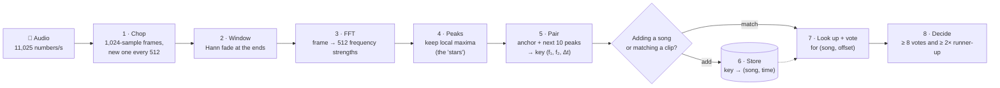

# How does AudioMatch recognise a song?

> [!abstract] Contents
> **Part 1 · The big picture**: the whole algorithm in plain words, one diagram and one key idea.
> **Part 2 · Walk-through**: every step with its maths, a real trace from our code and the figures.
> **Part 3 · Presenting it**: the 3-minute script, self-test questions, results, demo and Q&A.
>
> Every number here comes from our code (`audiomatch/fingerprint.py`, `matcher.py`, `database.py`) or the README results. The figures in Part 2 come from a real run on the noisy test clip `song_03_t12_8s_snr10.wav`, an 8 s clip of song_03 starting at 12 s with added noise.

---

# Part 1 · The big picture

## The problem in one sentence

You tap record halfway through a chorus. Your phone calls that moment **zero**. The song has been playing for a while. AudioMatch has to work out **which song** this is and **where the phone's zero falls in it**.

## The idea in one paragraph

A recording is a messy list of numbers. Noise, the room and the phone's microphone all change those numbers. Some things survive all of that, though. **Which notes are loudest, and how far apart in time they are**, stay the same. AudioMatch keeps only those landmarks. It turns each pair of landmarks into a short code called a **key**. It then looks those keys up in a database built from the full songs. If many keys from the clip point to the **same song** *and* the **same starting point**, that song is the answer.

## The pipeline



| Step | Plain words | Output for our 8 s test clip |
|---|---|---|
| Audio | Air pressure measured 11,025 times a second | 88,200 numbers |
| 1–2 Chop and window | Short, overlapping slices with faded ends | 171 frames × 1,024 numbers |
| 3 FFT | How strong each pitch is in each slice | 512 bins × 171 frames (the spectrogram) |
| 4 Peaks | The loudest spots in their neighbourhood | 638 peaks |
| 5 Pairs | Each peak joined with its next 10 peaks | 6,325 keys |
| 6–7 Look up and vote | Every database match votes for a song and a start time | 3,682 votes across 8 songs |
| 8 Decide | Is one (song, start) pile clearly the biggest? | **song_03, 11.98 s** (the truth is 12 s) |

## The key idea: slide two sounds into place

Imagine you hear a **low note**, then a **high note**. A **frame** is one tick of AudioMatch's clock, 512 samples or about 46.4 ms.

| Where you hear them | Low note | High note | Gap |
|---|---:|---:|---:|
| Your clip | frame 20 | frame 32 | 12 frames |
| Song A | frame 120 | frame 132 | 12 frames |

**Where does the clip start in Song A?** Try it before opening the answer.

> [!question]- Show me the alignment
> Slide the clip forward **100 frames**. Its low note lands on 120 and its high note lands on 132. Both line up. The clip's zero lands on **frame 100** of the song, which is 100 × 512 / 11,025 ≈ **4.64 seconds** in.

![[am-anim-SlideIntoPlace.mp4]]

Two numbers do different jobs:

- **12** is the gap *inside* the pair. It stays the same wherever you start recording, so we can **look it up**.
- **100** is the shift *between* the recordings. It tells us **where the clip might have started**.

One pair casts **one vote** for "Song A, shift 100". A single vote could be luck. When dozens of other pairs vote for the same song and the same shift, it is not luck.

> [!tip] The one-breath version
> "We turn a clip into a map of frequencies over time. We link strong peaks into pairs and look the pairs up. When enough pairs point to the same song and the same start time, we have a match."

---

# Part 2 · Walk-through with the maths

## Step 0 · Sound as numbers

A microphone measures air pressure. Our files store it as numbers $x[0], x[1], x[2], \dots$, taken $f_s = 11{,}025$ times a second. The code divides each 16-bit integer by 32,768, so each value lies between −1 and 1 (`load_wav`).

The **sampling theorem** says that a sample rate of $f_s$ can only represent frequencies up to $f_s/2$:

$$f_{\max} = \frac{f_s}{2} = \frac{11{,}025}{2} = 5{,}512.5\ \text{Hz}$$

That limit covers melody and most harmonics, and a lower rate means less data to process. An 8 s clip has $8 \times 11{,}025 = 88{,}200$ samples.

## Step 1 · Chop into overlapping frames

Music changes over time, so we analyse it in short slices called **frames**. Each frame has $N = 1024$ samples, about 92.9 ms. A new frame starts every $H = 512$ samples, about 46.4 ms. $H$ is called the **hop**. Each frame shares half its samples with the next one.

$$\text{frame}_m[n] = x[mH + n], \qquad n = 0,\dots,N-1$$

$$\text{number of frames} = \left\lfloor \frac{L - N}{H} \right\rfloor + 1 = \left\lfloor \frac{88{,}200 - 1{,}024}{512} \right\rfloor + 1 = 171$$

**Why overlap?** A note that starts near the edge of one frame sits near the middle of the next one. Overlap stops short events from being missed.

**Time resolution:** one frame index is $H/f_s = 512/11{,}025 \approx 0.0464$ s. Every "time" in AudioMatch, including the final start time, is counted in these 46.4 ms ticks.

## Step 2 · Fade the edges with a Hann window

Cutting a frame out of a wave usually leaves a sudden jump at each end. The FFT treats the frame as if it repeats forever, so it sees that jump as a sharp click. A click contains many frequencies, so energy smears into bins that were not really loud. This smearing is called **spectral leakage**. To reduce it, multiply each frame by a smooth bump that is 0 at both ends and 1 in the middle:

$$w[n] = \tfrac12\left(1 - \cos\frac{2\pi n}{N-1}\right), \qquad \tilde x_m[n] = w[n]\,\text{frame}_m[n]$$

![[am-1-chop-window.png]]

*Top: three overlapping frames on the real clip. Middle: the Hann window. Bottom: one frame before (grey) and after (blue) windowing.*

## Step 3 · The FFT: which pitches are in this frame?

### What we want

For each frame, we want to know **how strong each frequency is**. The **discrete Fourier transform (DFT)** gives exactly that. It compares the frame with a pure wave at each frequency $k$:

$$X[k] = \sum_{n=0}^{N-1} \tilde x[n]\, e^{-2\pi i k n / N}, \qquad k = 0,\dots,N-1$$

- $e^{-2\pi i k n/N} = \cos(2\pi kn/N) - i\sin(2\pi kn/N)$ is a pure wave that completes $k$ cycles in the frame.
- The sum is large when the frame "moves with" that wave. The **magnitude** $|X[k]|$ is the strength of frequency $k$.
- Bin $k$ corresponds to the frequency
$$f_k = k\,\frac{f_s}{N} = k \times \frac{11{,}025}{1{,}024} \approx k \times 10.77\ \text{Hz}$$
  For example, bin 41 ≈ 441 Hz (close to concert A, 440 Hz) and bin 61 ≈ 657 Hz.
- For a real-valued signal, bins $N/2$ to $N-1$ mirror bins $0$ to $N/2 - 1$. The code therefore keeps only the first **512 bins**, covering 0 to 5,512 Hz.

![[am-2-one-fft.png]]

*One frame of the real clip after the FFT. Each spike is a note or a harmonic that is present in that frame.*

### Why a *fast* Fourier transform

The DFT formula computes $N$ outputs, and each output is a sum of $N$ terms. That is $N^2$ multiplications, or 1,048,576 for $N = 1{,}024$. The **FFT** (Cooley–Tukey, radix-2) gets the **same numbers** with about $N\log_2 N = 10{,}240$ steps. It splits the sum into even- and odd-indexed samples:

$$X[k] = \underbrace{\sum_{m=0}^{N/2-1} \tilde x[2m]\, e^{-2\pi i k m/(N/2)}}_{E[k]\ =\ \text{FFT of even samples}} \;+\; W^k \underbrace{\sum_{m=0}^{N/2-1} \tilde x[2m+1]\, e^{-2\pi i k m/(N/2)}}_{O[k]\ =\ \text{FFT of odd samples}}, \qquad W = e^{-2\pi i/N}$$

Since $W^{k+N/2} = -W^k$ and $E, O$ repeat every $N/2$, one pair of half-size results gives **two** outputs:

$$X[k] = E[k] + W^k O[k], \qquad X[k + N/2] = E[k] - W^k O[k]$$

Repeat the split until each piece has 1 sample. The cost satisfies

$$T(N) = 2\,T(N/2) + O(N) \;\Rightarrow\; T(N) = O(N\log N)$$

because there are $\log_2 N = 10$ levels of splitting, with $O(N)$ work per level. Our code does exactly this:

```python
def fft(frames):
    n = frames.shape[-1]
    if n == 1:
        return np.asarray(frames, dtype=np.complex128)
    even = fft(frames[..., 0::2])                    # E
    odd  = fft(frames[..., 1::2])                    # O
    twiddle = np.exp(-2j * np.pi * np.arange(n // 2) / n)   # W^k
    return np.concatenate([even + twiddle * odd,     # X[k]
                           even - twiddle * odd],    # X[k + N/2]
                          axis=-1)
```

![[am-7-fft-cost.png]]

![[am-anim-FFTSplit.mp4]]

**Measured (README):** our FFT matches `numpy.fft` to within $10^{-13}$. It is **5× faster** than a direct DFT at 1,024 samples and **18× faster** at 4,096. The gap is smaller than the 100× in the operation count because Python's recursion overhead is large. The trend is the same, though: the bigger $N$, the bigger the win.

## Step 4 · Spectrogram, then keep only the peaks ("stars")

Stack every frame's 512 magnitudes side by side to get the **spectrogram**:

$$S[f, t] = |X_t[f]|, \qquad f = \text{frequency bin } (0..511),\ t = \text{frame } (0..170)$$

It is an image: time runs left to right, pitch runs bottom to top, and brightness shows strength.

Most of that image is not useful, so AudioMatch keeps only **peaks**. A point $(f, t)$ is a peak when **both** of these hold (`find_peaks`, `box_size=5`, `threshold=2`):

1. **It is the loudest point in its 11 × 11 box.** The box spans 5 bins and 5 frames on each side:
   $$S[f,t] = \max_{|f'-f|\le 5,\ |t'-t|\le 5} S[f', t']$$
2. **It is clearly louder than its own frame's typical level:**
   $$S[f,t] > 2 \cdot \operatorname{median}_{f'}\, S[f', t]$$
   The bar is set **per frame**, not for the whole song. With a single bar for the whole song, one loud moment would raise it so much that quiet passages lost all their peaks.

**Why peaks?** Noise adds energy everywhere, but a strong note usually stays the strongest thing in its neighbourhood. Some peaks still disappear in noise, so the next steps only need **some** of them to survive.

![[am-3-spectrogram-peaks.png]]

*The real clip: horizontal bright lines are held notes. Cyan circles are the 638 peaks. Peaks scattered in the dark background are noise peaks. They rarely produce keys that match the database at a consistent offset, so the voting step ignores them.*

## Step 5 · Pair the peaks into keys (fingerprints)

Sort peaks by time. Treat each peak as an **anchor** and pair it with the **next 10 peaks**, called its **targets**. Each pair becomes one record (`make_hashes`, `max_pair=10`):

$$\underbrace{(f_a,\ f_t,\ \Delta t = t_t - t_a)}_{\text{key, used for lookup}} \quad\text{stored with}\quad \underbrace{t_a}_{\text{anchor time}}$$

**Count check:** 638 peaks × 10 targets, minus the last 10 anchors that have fewer than 10 targets after them (10 + 9 + … + 1 = 55), gives 6,380 − 55 = **6,325 keys**. That matches the trace.

![[am-4-pairs.png]]

*One real anchor (blue) and its 10 targets. Several peaks often share a frame, so many targets sit at Δt = 0 or 1.*

**Why pairs instead of single peaks?** A single peak is just one bin, one of 512 values, and every song contains bin 41 somewhere. A pair must match two frequencies **and** a gap, which gives up to $512 \times 512 \times (\text{gaps})$ possible keys. Random matches become much rarer.

- **Evidence (README baselines, 25 songs):** single-peak lookup returned **241,508** database hits. Pair keys returned **20,853**, about **12× fewer**, with the same accuracy.
- **Why** $\Delta t$ **and not absolute times?** $\Delta t$ is the gap *inside* the pair, the "12" from Part 1. It is the same whenever you start recording. The absolute time $t_a$ is stored separately because it is needed for voting.

> [!note] A detail worth knowing
> The code uses `abs(anchor_time - target_time)`. Peaks are sorted by time first, so this is always $t_t - t_a \ge 0$.

![[am-anim-PeaksToKeys.mp4]]

## Step 6 · Store the song (indexing)

When a song is **added**, the same Steps 0–5 run on the whole song. Each record goes into one SQLite table:

| anchor_freq | target_freq | time_gap | song | time_in_song |
|---|---|---|---|---|
| 41 | 61 | 12 | Song A | 120 |

An **index** on `(anchor_freq, target_freq, time_gap)` works like a hash table. Finding every row for a key does not scan the table. To **match**, the code puts the clip's distinct keys in a temporary table and runs **one JOIN** (`database.lookup`). The result is `key → [(song, time_in_song), …]`.

## Step 7 · Vote for (song, offset)

### The maths of why it works

Let the clip start $\delta$ frames into the true song. A landmark heard at clip time $t_{\text{clip}}$ was played at song time

$$t_{\text{song}} = t_{\text{clip}} + \delta$$

Rearranging gives

$$\boxed{\ \text{offset} = t_{\text{song}} - t_{\text{clip}} = \delta\ }$$

The offset is **the same number for every correct hit**, whatever moment in the clip the hit comes from. A wrong hit has a random key collision and a random $t_{\text{song}}$. Wrong hits therefore spread across many different offsets. The vote counts every hit (`matcher.vote`):

```python
for clip_key, clip_time in clip_hashes:
    for song, song_time in hits.get(clip_key, []):
        votes[song][song_time - clip_time] += 1
```

Plot every hit as a point (clip time, song time). Correct hits fall on the line $y = x + \delta$, a diagonal. Random hits scatter.

![[am-5-scatter.png]]

*Real data. Grey: all 504 hits that landed in song_03 (out of 3,682 across the 8 songs in the database). Blue: the 63 hits with offset 258 sit exactly on the line song time = clip time + 258.*

Counting votes per offset turns that diagonal into a single **spike**:

![[am-6-votes.png]]

*Left: song_03 has a spike of **63** votes at offset 258. A smaller bar of 20 votes sits at 259 because the clip started part-way between two frame ticks, so some peaks round one frame later. Right: the best wrong song, song_04, peaks at only **12**.*

![[am-anim-Voting.mp4]]

## Step 8 · Decide, then convert to seconds

For each song, take its **best offset**, the tallest pile, and that pile's vote count. Sort the songs by that count, giving $v_1 \ge v_2 \ge \dots$ (`rank`). The app answers only if (`decide`, `MIN_VOTES = 8`, `MIN_RATIO = 2`):

$$v_1 \ge 8 \qquad\text{and}\qquad v_1 \ge 2\cdot\max(v_2, 1)$$

- The first test rejects matches with **too little evidence**.
- The second test rejects matches that are **not clearly better than the next song**. This is why the app says "no match" for unknown songs and noise instead of guessing.

The start time in seconds is

$$t_{\text{start}} = \text{offset} \times \frac{H}{f_s} = \text{offset} \times \frac{512}{11{,}025}\ \text{s}$$

**Real trace:** $v_1 = 63$ (song_03) and $v_2 = 12$ (song_04). Since $63 \ge 8$ and $63 \ge 24$, the answer is a **match**. The start time is $258 \times 512/11{,}025 = 11.98$ s, against a true value of 12 s.

**Why the error is about 0.02 s:** the offset is a whole number of frames. A true start of 12 s is $12 \times 11{,}025/512 = 258.4$ frames (which is also why some votes land on 259), so the answer can be at most half a hop off: $\pm\tfrac12 \times 46.4\ \text{ms} \approx \pm 0.023$ s. That matches the README result that start times were within 0.02 s.

## Complexity summary

Let $N$ = samples per frame (1,024), $L$ = samples in the clip, and $h$ = database hits.

| Stage | Time | Why |
|---|---|---|
| FFT, one frame | $O(N\log N)$ | split into halves $\log_2 N$ times, with $O(N)$ work per level |
| Spectrogram | $O(L\log N)$ | about $2L/N$ frames × $O(N\log N)$ each |
| Peaks and keys | $O(L)$ | fixed 11 × 11 box and fixed 10 targets per peak |
| Look-up and vote | $O(h)$ | about $O(1)$ per key through the index, plus one vote per hit |
| **Matching a clip** | $O(L\log N + h)$ | |

> [!info]- Full trace of the real clip (copy for the demo)
> | Quantity | Value | Where it comes from |
> |---|---|---|
> | Samples | 88,200 | 8 s × 11,025 |
> | Frames | 171 | ⌊(88,200 − 1,024)/512⌋ + 1 |
> | Spectrogram | 512 × 171 | bins × frames |
> | Peaks | 638 | 11 × 11 local max, > 2 × frame median |
> | Keys | 6,325 | 638 × 10 − 55 |
> | Distinct keys found in DB | 782 | SQL JOIN |
> | Votes (hits) | 3,682 | one per (key, stored row) pair |
> | Best | song_03, offset 258, 63 votes | |
> | Runner-up | song_04, 12 votes | |
> | Answer | song_03 at 11.98 s | 258 × 512 / 11,025 |

---

# Part 3 · Presenting it

## Minute 1 · Slide two sounds into place

Use the table from Part 1. Ask the audience where the clip starts. Then play `am-anim-SlideIntoPlace.mp4`. Land the two numbers: **12** is the gap we look up, and **100** is the shift we vote for.

## Minute 2 · Where did those two notes come from?

1. **Chop.** The mic measures air vibration 11,025 times a second. Take 1,024 measurements at a time and slide forward 512. A **Hann window** fades the ends of each slice so a sharp cut adds less unwanted frequency content.
2. **Picture.** The **FFT** measures the strength of each frequency in a slice. Put the columns side by side to make a **spectrogram**: *which frequency was strong, and when*.
3. **Stars.** Keep a spot if it is the strongest in its 11 × 11 neighbourhood and above twice its frame's median.
4. **Lines.** Pair each peak with the next ten. Two peaks in bins 41 and 61, 12 frames apart, give the key **(41, 61, 12)**.
5. **Vote.** Look up each key. Each hit votes for **(song, stored frame − clip frame)**. Our pair votes for **(Song A, +100)**.

## Minute 3 · Can you do it without looking?

Answer aloud, then tap to check.

> [!question]- A new pair starts at frame 45 in the clip and 145 in Song A. Which pile gets its vote?
> **Song A, +100.** A different pair points to the same start. A hit at 180 instead would vote for +135 and land in another pile.

> [!question]- Song A's biggest pile has 9 votes. Song B's has 5. Do we name Song A? What if B has 4?
> **9 vs 5 → no match.** We need at least 8 votes and at least double the runner-up. Nine falls short of ten. **9 vs 4 → match.** Nine is at least eight and more than double four.

> [!question]- Why might a noisy recording work while humming the same tune fails?
> Noise can leave enough of the recording's peak pairs intact. Humming changes the frequencies and often the timing, so most keys change. Very short or quiet clips can also yield too few pairs.

> [!question]- Why store Δt in the key but the anchor time separately?
> Δt does not depend on when recording started, so it can be looked up. The anchor time does depend on it, and that is what makes it useful for voting on the offset.

> [!question]- Bin 41 is what frequency?
> 41 × 11,025 / 1,024 ≈ **441 Hz**.

> [!question]- Why does the FFT give the same answer as the DFT but faster?
> It splits the sum into even and odd samples. Each half is a DFT of half the size, and one pair of half results gives two outputs ($E \pm W^kO$). That gives $\log_2 N$ levels of $O(N)$ work, so $O(N\log N)$ instead of $O(N^2)$.

## What the results mean

| If someone asks… | What to say |
|---|---|
| How fast was recognition? | "An 8-second clip took about **89 ms** on 5 songs and **129 ms** on 25 songs. Brute force, sliding the spectrogram over every song, took **1.26 s** on 25 songs, about **10× slower**." |
| How robust is it to noise? | "With 8-second clips, it was **100% correct down to 0 dB SNR**, where the noise is as loud as the music. It was 80% correct at −10 dB." |
| How accurate was the start time? | "Within **0.02 s** in our correctness tests. That is the limit set by the 46 ms frame tick." |
| How short can a clip be? | "At 0 dB noise: 100% correct from **5 s**, 60% at 3 s, 10% at 1 s." |
| Did the FFT itself help? | "Against a direct DFT, our FFT was **5× faster at 1,024 samples** and **18× at 4,096**. All **9 algorithm tests** and **19 API tests** passed." |

## Demo and Q&A reference

> [!example]- Run the demo
> **Find** a known song and show its name, start time, votes and match time. **Explain** the five steps in "How it was matched". **Refuse** an unknown recording or noise. **Learn** by adding a song and recognising a fresh clip of it. Keep a prerecorded clip ready.
>
> **Session:** 5 minutes for the talk and live demo, then 5 minutes of questions. **My contribution:** core algorithm and front end, including the recording flow and match explanation.

> [!note]- If the discussion goes further
> **Limits and improvements.** The project recognises indexed recordings. Covers, live versions and speed or pitch changes alter the keys, because they shift $f_a$, $f_t$ or $\Delta t$. Possible extensions: fingerprints that survive tempo and pitch shifts, a larger persistent index, and tuning peak selection.
>
> **Mic and music.** Per the README, the app never saves recordings or uploads. It only listens while the button is on, and it only keeps fingerprints of songs added to the database. The shipped music is CC BY 4.0 (Kevin MacLeod) or our own.
>
> **Before Q&A.** Trace one hit through the FFT, peak selection and voting code, including Thomas's backend. For AI use, follow the README and explain the tool, its purpose and how the team checked its output.
>
> **Source paper.** Avery Wang, *An Industrial-Strength Audio Search Algorithm* (2003): https://www.ee.columbia.edu/~dpwe/papers/Wang03-shazam.pdf

## Animations and figures

All files are in the `audiomatch figures/` folder next to this note:

| File | What it shows |
|---|---|
| `am-anim-SlideIntoPlace.mp4` | Part 1 key idea: the fixed gap vs the shift |
| `am-anim-FFTSplit.mp4` | DFT → even/odd split → $O(N\log N)$ |
| `am-anim-PeaksToKeys.mp4` | spectrogram → peaks → anchor/target key |
| `am-anim-Voting.mp4` | votes stacking at one offset, decision rule |
| `audiomatch_manim.py` | ManimGL source for the four videos |
| `make_figures.py` | regenerates the `am-*.png` figures from the project code |

To re-render the animations with ManimGL (3Blue1Brown's `manimgl` package, v1.7.2 tested):

```bash
pip install manimgl "setuptools<81"          # needs ffmpeg, and LaTeX for formulas
cd "audiomatch figures"
manimgl audiomatch_manim.py SlideIntoPlace       # live preview window
manimgl audiomatch_manim.py -a -w -m             # write all four scenes as 720p .mp4
```

[Watch the worked example](https://chatgpt.com/library?file_id=libfile_fde3_f-8f51670cd528819184849080d6586f3f_d0bc3df161f8819184b09d438e9d9b4d&account_id=personal) · At **1:01** the clip slides into place. At **1:14** the votes begin to stack.
